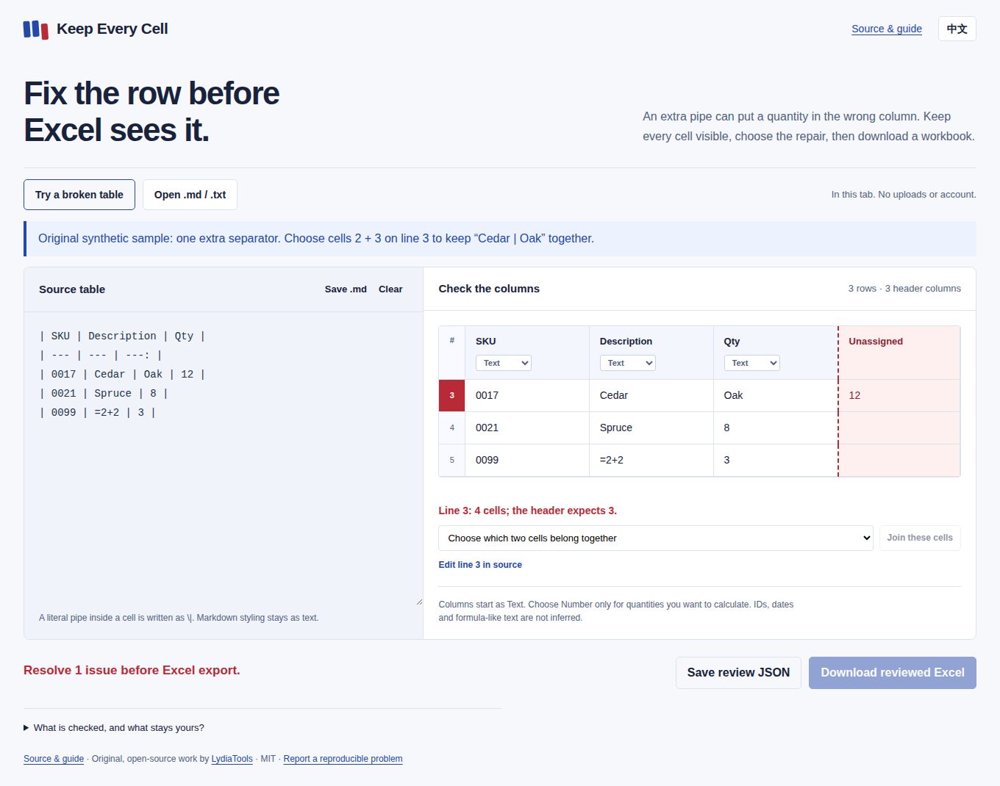
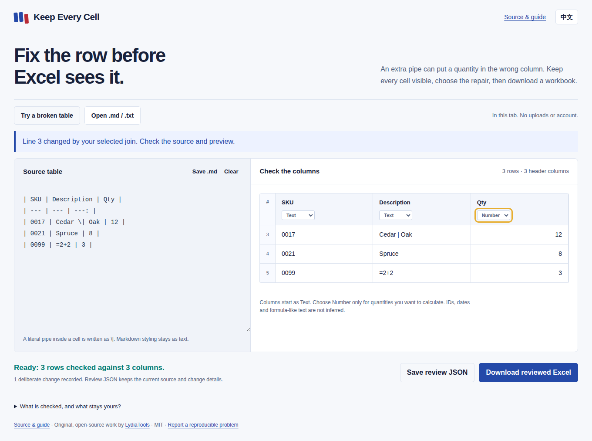

# Keep Every Cell

**A four-cell row is not a three-column table.**

Review an AI-generated Markdown table before handing it to Excel. Keep extra
cells visible, choose the repair yourself, and export a workbook with deliberate
column types. English and Chinese interface. No account, upload or model API.

[Try the app](https://lydiatools.github.io/keep-every-cell/) · [Download the offline ZIP](https://github.com/LydiaTools/keep-every-cell/releases/download/v0.1.0/keep-every-cell-v0.1.0.zip) · [简体中文](README.zh-CN.md) · [Source](https://github.com/LydiaTools/keep-every-cell) · [Reproducible feedback](https://github.com/LydiaTools/keep-every-cell/issues)



## The moment this helps

You expected three columns:

```text
| SKU  | Description | Qty |
| ---- | ----------- | --- |
| 0017 | Cedar | Oak | 12  |
```

There are four cells in that data row. Should `12` be discarded, should a fourth
column be invented, or did `Cedar | Oak` belong in one cell?

Keep Every Cell leaves all four visible and stops Excel export. You choose the
adjacent cells to join, or edit the source. The intended repair above becomes
`Cedar \| Oak`; `0017` stays text, and Qty becomes numeric only if you select Number.
It does not decide what the author meant.

## Try it

Open `index.html` in a current browser. No build or package installation is
needed for the app; its scripts and styles are local files.

1. Click **Try a broken table**, or paste one Markdown table.
2. Inspect the highlighted line. For the original sample, choose cells **2 + 3**
   on line 3 and click **Join these cells**.
3. Leave IDs as Text. Choose Number for a quantity column if you want calculations.
4. Use **Save .md** to keep a source copy that you can open later. Download the reviewed `.xlsx`, or save review JSON to retain the current
   source, parsed cells, issues, types and explicit join records.

Text columns keep leading zeros, long identifiers and formula-like strings as
strings. Numeric columns accept plain decimals with at most 15 significant
digits; ambiguous values block export. Numeric conversion can change spelling
or display. No dates or formulas are inferred.

<details>
<summary>See the same table after an explicit repair and quantity-type choice</summary>



</details>

[Recorded CI, workbook readback and screenshot provenance](docs/verification.md).

## What is different

| Decision | Behavior |
|---|---|
| A row has more cells than the header | Show the extra values as unassigned; block Excel export |
| A row has fewer cells | Report the line; do not pad it automatically |
| Two values belong in one cell | Require an explicit adjacent-cell choice; record before/after source |
| A code looks numeric | Start as Text; Number is a deliberate column choice |
| The table contains markup | Display literal strings; do not render user HTML |
| You want to inspect the review | Export arrays and source, preserving duplicate/empty header names |

This is a stricter review workflow, not a claim that every converter loses data.
The inspected web comparator kept the extra value by expanding the table and
allowed export. The optional pinned comparison uses **tablemd 0.1.0** on one
original synthetic ragged row; that library documents its GFM-style row
normalization. These are different policies, not a general accuracy ranking.
[Method and provenance](docs/method.md).

## Run the checks

Node 20+ for the dependency-free core checks:

```sh
npm test
node tests/write-fixtures.cjs
```

Browser and independent workbook readback (development dependencies only):

```sh
npm install
npx playwright install --with-deps chromium
npm run test:browser
python3 -m pip install openpyxl==3.1.5
python3 tests/check_workbooks.py
```

The optional comparison `python3 scripts/compare_tablemd.py` downloads a pinned,
SHA-256-checked MIT-licensed wheel into a temporary directory. It is not an app
dependency. Use an isolated environment; CI runs it without repository credentials.
Inspect the [actual CI result](https://github.com/LydiaTools/keep-every-cell/actions/workflows/checks.yml)
before treating the workflow file as a successful run.

## Scope and privacy

Early preview: **one pipe-delimited Markdown table**, optional outer pipes and
a whole `markdown` code-fence wrapper. A newline ends a row; a blank line ends
the table. A contiguous line without pipes is retained as a one-cell row and
checked against the header. Blank-separated prose remains in source and is
explicitly excluded from the workbook. Ordinary
code blocks are not imported. Markdown styling stays literal. This is not a full
GFM renderer, PDF/OCR extractor, CSV cleaner or AI fact checker.

UTF-8 input limit: 256 KiB; 1,000 data rows; 32 header columns; 20,000 data cells;
32,767 characters per cell. The preview displays the first 50 rows and, for an invalid over-wide row, 64
columns; all parsed cells remain in source and review JSON. Over-limit
data blocks export instead of producing a partial workbook. Input is held in
the tab and is not restored after reload. Review JSON is an audit record, not a re-import project file. Use Save .md
to continue from source later. Review JSON includes the text you
choose to download; keep it private when your source is private.

The app has no runtime dependencies, analytics or network client. Its content
security policy blocks connections. Website hosting still receives ordinary
page/asset requests; file contents are not put in URLs. Native Excel, Numbers,
Safari and screen-reader acceptance are separate from Chromium and openpyxl checks.
No claim is made about the truth of a table's values, general AI reliability,
user adoption, savings or future Stars.

## License

MIT for this independently written, AI-assisted implementation. No converter
source or interface assets are copied. Third-party comparison tools retain
their own licenses. Built by [LydiaTools](https://github.com/LydiaTools).
